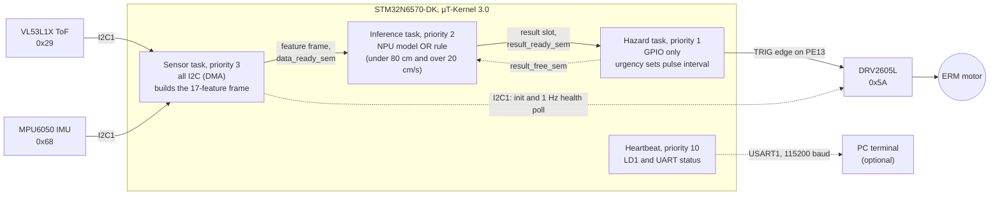
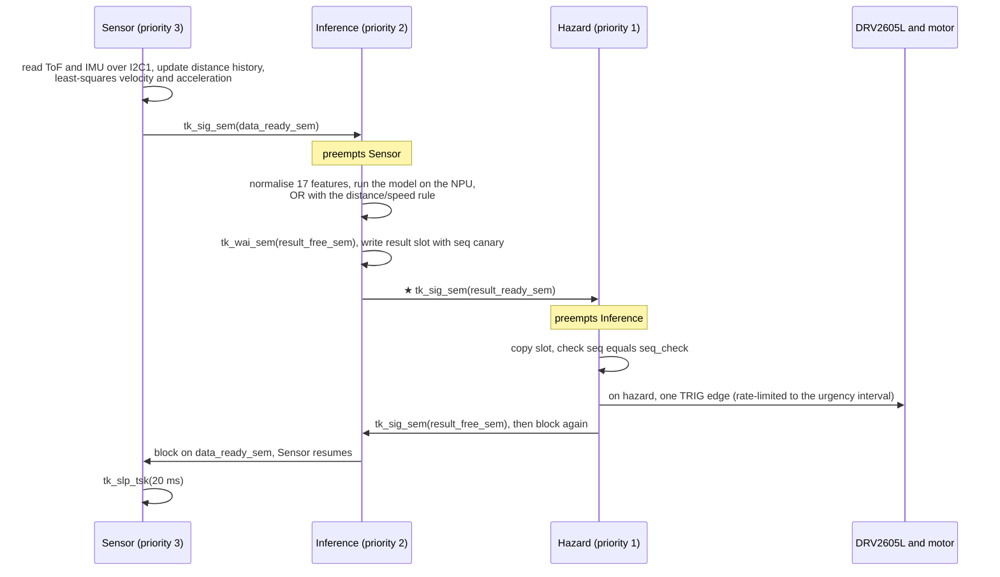

# Haptic-Sense

[](https://github.com/Kavin-Re/Haptic-Sense/actions/workflows/ci.yml)
[](#license)


> **Status: frozen, 2026-11-23.** The contest entry is submitted and no new features are planned.
> **Not done:** the firmware defects documented under [Limitations](#limitations) are left unfixed, so
> that the source still matches the submission.

**Benchtop prototype of an obstacle-urgency alert meant for visually impaired users: a time-of-flight sensor
and an IMU on an STM32N6 under µT-Kernel 3.0, with a haptic motor that pulses faster as an obstacle closes.
It gives urgency, not direction, and has not yet been tried by a visually impaired user.**

TRON Forum Programming Contest 2026 — Entry ID **34476** — RTOS Application category (Students,
individual entry) — [tron.org](https://www.tron.org/programming_contest-2026/)

Author: Kavin K K, B.Tech Electronics Engineering (VLSI), Rashtriya Raksha University.

---

## Summary

A time-of-flight sensor, an IMU and a haptic motor on an STM32N6570-DK, running four tasks
under **µT-Kernel 3.0**. A small INT8 model on the Neural-ART NPU, ORed with a fixed
distance/speed rule, decides when an obstacle is closing fast enough to be a hazard; the
motor then buzzes at a rate that scales with urgency. The handoff from "inference result
posted" to "priority-1 hazard task running" was measured on hardware at **3.375 µs** worst
case (logic analyzer) and **4.19 µs** (in-firmware cycle counter, 30-minute soak on the full
pipeline).

- It is a **benchtop prototype**, not a finished wearable enclosure.
- Feedback is strictly "how urgent", never "which way": the single-zone sensor cannot
  measure direction, and this project does not claim it does.

## Results at a glance

Every number below is a measurement already recorded in this repository; the last column
says where.

| What | Result | Evidence |
|---|---|---|
| Hazard-task preemption latency, worst case — logic analyzer, GPIO pin to pin, 125 ns resolution; synthetic sensor data, extra CPU load | **3.375 µs**, 2,229 events, 0 missed (baseline without load: 1,776 events, same result) | [`docs/evidence/phase4/`](docs/evidence/phase4/) |
| Same handoff — firmware DWT cycle counter at 800 MHz; real sensors + NPU inference, 30-minute continuous soak | **4.19 µs** (3,349 cycles), 43,723 events | [`docs/evidence/phase6/`](docs/evidence/phase6/README.md) |
| Torn reads across the paired-semaphore handoff, same soak | **0** in 48,242 frames (`canary_err = 0`) | same |
| Sensor frame rate, full pipeline | ~27 Hz (~37 ms period) | same |
| Haptic effect playback time (sets the 75 ms pulse-interval floor) | 58,605–58,708 µs, n = 5 | `CLAUDE.md` §8, H-D3 |
| Model v4 on 3,721 held-out rows, at its own threshold (p = 0.20) | recall 81.3 %, precision 64.1 % | [`model/README.md`](model/README.md) |
| Same model at the threshold the firmware ships with (p ≈ 0.30) | recall 73.5 %, precision 69.5 % | same |
| Training data | 37,216 rows from 60 recordings | [`data/README.md`](data/README.md) |

The two latency figures use different methods and different builds; both are more than 200×
under the 1 ms target the project set for itself. Both measure the
inference-task-posts-result → hazard-task-wakes handoff (the "< 1 ms path" in the
[task table](#rtos-architecture)), not end-to-end sensor-to-motor latency, which is set by
the ~37 ms sensor frame period. The model figures come from a row-level split of the same
recordings and are optimistic; see [Limitations](#limitations).

## How it works



One sensor frame, end to end. Each `tk_sig_sem` wakes a higher-priority task, which runs
immediately; the step marked ★ is the handoff the two latency figures measure.



## RTOS architecture

Four µT-Kernel 3.0 tasks, priority = lower integer = higher priority:

| Priority | Task | Waits on | Constraint |
|---|---|---|---|
| 1 | Hazard Alert | `result_ready_sem` | GPIO only — no I/O, no I2C, no `tm_printf`. This is the < 1 ms path. |
| 2 | TinyML Inference | `data_ready_sem`, `result_free_sem` | Reads the sensor buffer via a paired semaphore, runs the on-device model. |
| 3 | Sensor Acquisition | 20 ms delay per frame | Owns all I2C traffic, DMA-mode only, never blocking. |
| 10 | Heartbeat | 1 s delay | Liveness indicator, lowest-frequency task. |
| — | Idle | — | Busy-spin: the port's `low_pow()` is empty, so the core never sleeps and never pays a wake-up latency (see [Limitations](#limitations) for the power cost). |

Producer/consumer handoffs between tasks use paired counting semaphores
(`tk_cre_sem` / `tk_wai_sem` / `tk_sig_sem`), never raw task wakeups, so no result buffer is
ever read half-written. The producer also stamps a `seq` / `seq_check` pair first and last
in the result slot; a mismatch on the consumer side would be a torn read, and is counted as
`canary_err`. The µT-Kernel API is used throughout — no FreeRTOS calls appear anywhere in
this codebase.

The Hazard Alert task's "GPIO only" rule is about how it *drives* the motor, not about the
DRV2605L being wired for GPIO: the driver sits on I2C1, but its `IN/TRIG` pin (PE13) supports
a hardware edge-trigger playback mode, so the priority-1 task fires a haptic pulse with a
GPIO edge alone — no bus transaction on the hazard path. I2C to the driver is used only from
the priority-3 task: at initialization, to configure the playback library and mode, and
afterwards for a once-per-second health poll.

## Hardware

| Component | Part | Role |
|---|---|---|
| MCU board | STM32N6570-DK (STM32N657X0HXQ) | Cortex-M55 @ 800 MHz + Ethos-U55/Neural-ART NPU |
| Time-of-flight sensor | ST VL53L1X (7SEMI breakout) | Forward-facing distance, I2C1 @ 0x29 |
| IMU | InvenSense MPU6050 (GY-521 breakout) | Motion / closing-velocity signal, I2C1 @ 0x68 |
| Haptic driver + motor | TI DRV2605L (SmartElex breakout) + ERM motor | Urgency-graded haptic pulses, I2C1 @ 0x5A |

All three peripherals share a single I2C1 bus (PH9 = SCL, PC1 = SDA) — see `CLAUDE.md` §2 for
the full pin map, pull-up budget, and per-device wiring notes. The board is USB-powered with no
battery installed. The board schematic (MB1939-N6570-C02) is not redistributed here; it is a free
download from ST under ST's own license terms, on the
[STM32N6570-DK product page](https://www.st.com/en/evaluation-tools/stm32n6570-dk.html)
(CAD Resources → Schematic Pack, or
[direct PDF](https://www.st.com/resource/en/schematic_pack/mb1939-n6570-c02-schematic.pdf)).

## Operating the device

The unit ships already flashed and set to boot from flash. No PC, terminal, or debugger is
needed to run it.

1. **Check the boot switches:** BOOT0 and BOOT1 (PA6/SW1) both LOW (Flash Boot). Keep the
   sensor breakouts connected to the Discovery board.
2. **Power it:** plug a USB-C cable into the board's ST-LINK USB-C port. A C-to-C cable from a
   USB-C charger or PC port is recommended; a Type-A-to-C cable was measured to boot this build,
   but ST documents a ~550 mA limit for that case.
3. **Check it is alive:** after boot, the green user LED **LD1** toggles once per second. That
   is the lowest-priority heartbeat task; if it is blinking, the scheduler and all four tasks
   are running.
4. **Trigger an alert:** move a hand, or a flat object such as a book, **toward** the VL53L1X
   sensor window along its line of sight. The sensor measures up to roughly 1.3 m. An alert
   fires when an object inside **80 cm** is **closing faster than 20 cm/s** (the fixed rule),
   or when the on-device model predicts that is about to happen (see "The on-device model").
   A hand held still, or moving away, does not trigger it; this is deliberate.
5. **Read the vibration:** each alert is a short buzz from the ERM motor, repeated while the
   hazard lasts. The **repeat rate is the urgency**: about 400 ms between buzzes at 20 cm/s,
   4 ms shorter for every extra cm/s, down to a 75 ms floor at about 100 cm/s and faster. So a
   faster approach buzzes faster. It never indicates direction; the single-zone sensor cannot
   measure it.
6. **Stop it:** unplug the USB cable. There is no power switch and no state to save.

**Optional, with a PC:** the ST-LINK virtual COM port (USART1, 115200 baud, 8N1) prints status
lines. The `[HB]` line appears once per second: `frames` = sensor frames processed, `inf` =
inferences run, `hazard` = alerts fired since boot, `canary_err` = torn-read detector (should
stay 0).

## Build & flash

Toolchain: STM32CubeIDE ≥ 1.19.0, STM32CubeProgrammer ≥ 2.20.0 (older versions default to the
wrong Cortex-M55 flags), on Linux or Windows. The submitted build used STM32CubeIDE 2.2.0
(GNU Tools for STM32 14.3.rel1) and STM32CubeProgrammer 2.23.0.

1. Import `firmware/Appli` into STM32CubeIDE (File → Import → Existing Projects into
   Workspace). The project is named `STM32N6_MTK_Person_Detection_Appli`, a name inherited
   from the sample it was built from; that is the `<ProjName>` used below.
2. Place the two vendored dependencies noted below at `firmware/Lib/AI_Runtime/` and
   `firmware/STM32Cube_FW_N6/`.
3. Build (Debug configuration — this project has no separate Release build; the committed
   configuration has the diagnostic defines already removed and `HAZARD_CLASSIFIER_USE_NPU`
   set, which is the shipped configuration; the in-source `CSV_LOG_ENABLE` switch is still 1,
   see [Limitations](#limitations)).
4. Sign the output (required — an unsigned or unaligned binary boot-fails silently on this
   part). The post-build step does this automatically, calling
   `${HOME}/STMicroelectronics/STM32Cube/STM32CubeProgrammer/bin/STM32_SigningTool_CLI`
   (CubeProgrammer's default Linux install location). If yours is elsewhere, edit it under
   Properties → C/C++ Build → Settings → Build Steps. The command it runs:
   ```
   STM32_SigningTool_CLI -bin <ProjName>.bin -nk -of 0x80000000 -t fsbl -o <ProjName>-Trusted.bin -hv 2.3 -dump <ProjName>-Trusted.bin -align
   ```
   `-align` is mandatory for STM32CubeProgrammer ≥ 2.21. After every build, confirm
   `*-Trusted.bin` exists and is non-zero before flashing.
5. Flash, in this order, with STM32CubeProgrammer and the `MX66UW1G45G_STM32N6570-DK.stldr`
   external loader:
   - `binaries/ai_fsbl.hex` → `0x70000000`
   - `firmware/Model/STM32N6570-DK/network_data.hex` (model weights) → `0x71000000`
   - `<ProjName>-Trusted.bin` (the signed application) → `0x70100000`
6. Boot-pin configuration: Dev Boot = BOOT0 low + BOOT1 (PA6/SW1) high; Flash Boot = both low.
7. Debug UART is USART1 (PE5 TX / PE6 RX) over the ST-LINK VCP at 115200 baud.

See `CLAUDE.md` §1 and §4 for the full toolchain/boot detail, including a known documentation
drift in the upstream reference repo this project's µT-Kernel BSP port was built from.

Two large third-party dependencies are **not** tracked in this repository; they stay under
ST's own license terms. Obtain them yourself and place them at these paths before building:

| Path | What | Version this build used |
|---|---|---|
| `firmware/STM32Cube_FW_N6/` | ST HAL/CMSIS/BSP ([STM32CubeN6](https://github.com/STMicroelectronics/STM32CubeN6)), ~94 MB | **v1.2.0** |
| `firmware/Lib/AI_Runtime/` | ST Neural-ART runtime (`ll_aton`), ~68 MB | **v1.1.3-275**, as bundled with the code generated by ST Edge AI Core 4.0.1. `network.c` refuses to compile (`#error`) against any other runtime version, so it must come from the same generation run as `firmware/Model/`. |

## Host tests and CI

The decision logic can be exercised on a PC, without the board or the ARM toolchain:

```
make -C tests/host                                # C unit tests, gcc + ASan/UBSan
python3 -m unittest discover -s tests/tools -v    # data-tool tests, standard library only
ruff check .                                      # lint for tools/ and tests/
```

`tests/host` compiles the firmware sources **unmodified** against small stand-in headers
and checks the least-squares velocity estimator (including divide-by-zero and large-uptime
cases), the urgency → pulse-interval mapping, the model-OR-rule decision with its
boundaries, the canary, the feature-frame validity rules, and the integer classifier over
the 3,721 held-out rows. GitHub Actions runs these plus a Markdown link check on every push
([`.github/workflows/ci.yml`](.github/workflows/ci.yml)).

These are logic tests. They run no scheduler and no NPU, so they say nothing about timing
or preemption; that evidence is the hardware measurement above. Details:
[`tests/README.md`](tests/README.md).

## The on-device model

Pipeline: hardware data collection → Edge Impulse (feature engineering + training) → INT8
`.tflite` export → `generate-n6-model.sh` (ST NeuralART compiler) → `network.c` /
`network_data.hex`, compiled into the firmware image above.

- 17-feature input vector, one per sensor frame (~27 Hz measured on the full pipeline): 10
  frames of distance history, closing velocity, closing acceleration, 3-axis accelerometer,
  ToF ambient rate and signal rate. Features are computed on the device and uploaded to Edge
  Impulse as raw features, so the firmware is the only definition of the feature space.
- **Predictive label:** each training frame is labeled with the rule distance < 80 cm **and**
  closing velocity > 20 cm/s evaluated **12 frames (~0.44 s) later**, so the model learns
  "about to be a hazard", not "already is".
- A small fully-connected network (17→32→16→1, sigmoid output), INT8, using only NPU-safe
  operators — no recurrent or attention layers, which fall back to the CPU silently and 10-30×
  slower on this part. The firmware's weights come from `model/haptic_sense_hazard_v4.tflite`
  (held-out: recall 81.3 %, precision 64.1 % at p = 0.20); see [`model/README.md`](model/README.md).
- Two inference paths with the same interface: an integer-only C implementation (bit-exact
  against the TFLite interpreter on 3,721 held-out rows) and the Neural-ART NPU
  (`HAZARD_CLASSIFIER_USE_NPU`, the compiled default). The NPU weight-address bug in
  `docs/NPU_SATURATION_DEBUG_FINDINGS.md` was fixed (weights at `0x71000000`) and confirmed on
  hardware: in the 2026-09-19 soak the NPU output varies with the scene
  (`docs/evidence/phase6/`).
- **How a hazard is actually decided:** live testing on 2026-09-19 showed the model going quiet
  at point-blank, fast approaches. The firmware therefore ORs the model's decision with the
  rule distance < 80 cm **and** closing velocity > 20 cm/s (search "SAFETY-NET FALLBACK" in
  `app_tasks.c`). At close range the rule does most of the work; detection is model **or**
  rule, not purely learned.

## Limitations

Scope:

- This is a benchtop prototype, not a wearable enclosure. Where the build diverged from the
  original plan, it is recorded in this section and in `model/README.md` (which model the
  firmware actually carries, and why its threshold and weights come from different models).
- A single-zone ToF sensor has no directional resolution. Feedback here communicates urgency
  only, never direction — this is a deliberate scope decision, not a missing feature.
- No power measurement was taken, and the idle loop busy-spins. The original plan's deep-sleep
  mode was not built, because Stop/Sleep wake-up latency would threaten the < 1 ms guarantee.

Model:

- The model's decision threshold in `app_hazard_classifier.h` (`HAZ_PROB_THRESH_Q = -51`) was
  derived from a later model (v10) than the weights the firmware carries (v4; its own
  validated threshold is kept there as `HAZ_PROB_THRESH_Q_V4_LOCKED = -87`). See
  `model/README.md`. Hazard alerts are still produced by the rule above.
- The held-out set is a row-level 90/10 split: all 60 recordings contribute rows to both
  sides, and consecutive rows share 9 of their 10 distance samples. The held-out recall and
  precision are therefore optimistic compared with a split by recording
  ([`data/README.md`](data/README.md)).

Firmware, found in the November 2026 code review and **left as they are** so that the
source still matches the contest submission:

- **The `[CSV]` feature logger is still compiled in** (`CSV_LOG_ENABLE 1` in `app_tasks.c`).
  The priority-3 sensor task prints one line of about 170 characters per frame on the
  115200-baud UART, roughly 15 ms of polled output. That is consistent with the gap between
  the 20 ms pacing delay and the measured ~37 ms frame period, but the two have not been
  separated by measurement. The training data was captured at that rate, so switching the
  logger off changes the time base of the distance-history features and needs re-validation
  on hardware.
- **No watchdog.** The inference task waits for the NPU in an unbounded loop; if the NPU or
  a task hung, nothing would reset the board. The heartbeat LED stopping would be the only
  sign.
- **A stalled ToF sensor is detected but not acted on.** The feature frame carries a
  FRESH / HELD / INVALID state, but the inference task does not read it: if frames stop
  arriving, the last distance and velocity stay in place. The ToF driver has no runtime
  re-initialisation (the DRV2605L driver does).
- The velocity estimator is not safe across the 2³² ms (49.7-day) uptime wrap; up to five
  frames at that instant can compute a wrong velocity.
- The integer-only CPU inference path (not the compiled default) pairs a v10-derived logit
  threshold with v4 weights. On the held-out rows that gives 51.8 % recall, against 81.2 %
  at v4's own logit threshold (`tests/host/test_hazard_classifier.c`).
- The two files replaced on 2026-09-25 ([`docs/PROVENANCE.md`](docs/PROVENANCE.md)) were
  build-verified but not re-flashed: the unit shipped for judging carries the earlier
  binary.

Host tests cover decision logic only; nothing in CI builds or runs the firmware.

## Roadmap

Frozen on 2026-11-23; the items below are not scheduled.

Not started. Listed in the order they would reduce risk; each firmware item needs a
hardware re-test before any figure in this README carries over.

1. Act on sensor validity: treat an INVALID ToF state as "no hazard information", and add
   runtime re-initialisation for the VL53L1X.
2. Add an independent watchdog (IWDG) kicked from the heartbeat task, and bound the NPU wait.
3. Move per-frame logging off the sensor task (or disable it), re-measure the frame rate,
   and re-collect data at the new rate.
4. Retrain on a split by recording, convert that one model for the NPU, and derive both
   thresholds from the same weights with live validation.
5. Make the velocity estimator wrap-safe.
6. Measure power; evaluate WFI in the idle loop against the latency budget.
7. Direction: the kit's MB1854B camera module carries a multi-zone VL53L5CX on the same bus
   (`CLAUDE.md` §2, "Onboard upgrade path"). Not integrated.
8. A wearable enclosure and battery power.

## Repo map

```
firmware/               STM32CubeIDE project (µT-Kernel 3.0 + the sensor/actuator/inference code)
  Appli/Core/           Application sources: app_tasks.c (the four tasks), app_i2c.c, the
                        sensor and haptic drivers, velocity_lsq.c, app_hazard_classifier*.c
  Appli/mtk3_bsp2/      µT-Kernel 3.0 BSP2 port (T-License)
  Model/                Generated NPU model artifacts (network.c/.h, network_data.hex) — the
                        inference code the board actually runs
  Lib/                  ST middleware used by the build (partly tracked; AI_Runtime is not)
  STM32Cube_FW_N6/      ST HAL/CMSIS/BSP package (not tracked)
binaries/               ai_fsbl.hex — the first-stage bootloader flashed at 0x70000000
model/                  The trained model (.tflite) the firmware is generated from, the
                        Neural-ART generation script and config — see model/README.md
data/                   The published datasets (training, Edge Impulse upload, held-out)
logs/                   One raw serial recording (the other 59 are not published)
tools/                  Data collection, aggregation, augmentation and evaluation scripts
tests/host/             Host-side C unit tests of the firmware's decision logic
tests/tools/            Python tests for tools/ and data/
docs/                   Design docs, audits and verification evidence — index in docs/README.md
docs/evidence/          Logic-analyzer captures, soak-test logs, and timing-campaign data that
                        back every hard performance claim in this README and in
                        docs/PROJECT_DEFENSE.md (the 2026-07-12 silent-failure catalogue and
                        verification ledger)
docs/dev-log/           Dated hand-offs, plans and runbooks from the build, kept as history
docs/PROVENANCE.md      Where each non-original file came from, and what was removed or replaced
THIRD_PARTY_NOTICES.md  Licence of each bundled component, by path
CLAUDE.md               The project's own engineering rulebook — hardware map, RTOS task rules,
                        red-zone tracking, code standards. The most detailed technical
                        reference in this repo; read it before modifying anything under
                        firmware/
```

## License

**This repo mixes licenses by component — read this section, not just the `LICENSE` file,
before reusing anything.**

- **Everything original to this project** — the firmware source under `firmware/Appli/Core/`
  that carries an `SPDX-License-Identifier: Apache-2.0` header, the docs, this README, and the
  data-collection/training scripts — is released under the **Apache License 2.0**, see
  `LICENSE`. This was chosen specifically because it doesn't try to impose terms on the
  T-Licensed and ST-licensed components below, unlike a copyleft license would.
- **The µT-Kernel 3.0 BSP2 port** (`firmware/Appli/mtk3_bsp2/`) is TRON Forum / Ken Sakamura
  code under **T-License 2.1/2.2**, unmodified except for configuration values and one
  patched driver, each noted in the changed file's header (`config/config.h`,
  `config/config_bsp/stm32_cube/config_bsp.h`, `mtkernel/device/common/drvif/msdrvif.c`). It
  keeps its own terms, included at
  `firmware/Appli/mtk3_bsp2/mtkernel/docs/TEF000-219-200401.pdf`. Any modified copy carries a
  changed-file note per T-License 2.2 Art. 3.2.
- **Generated/vendor-derived model and boot artifacts** (`firmware/Model/STM32N6570-DK/`,
  `binaries/ai_fsbl.hex`, the linker script, `model/generate-n6-model.sh`) originate from ST's
  STM32N6 sample tooling under **ST's SLA0044** and keep that license.
- **Vendored third-party libraries**: `firmware/Lib/AI_Runtime/` and `firmware/STM32Cube_FW_N6/`
  are **not tracked in this repository at all** and remain under ST's own license terms —
  obtain them separately (see Build & flash, above). The ST middleware that *is* tracked
  (`firmware/Lib/{Camera_Middleware,screenl,tracker,ai-postprocessing-wrapper,lib_vision_models_pp}`,
  `firmware/Appli/Lib/STSW-IMG009/`) keeps the license file shipped in each directory.
- **ST sample-application files** under `firmware/Appli/Core/` that keep an STMicroelectronics
  header (`main.c`, `stm32n6xx_it.c`, `app.c`, `app_cam.c`, `utils.c`, …) were adapted from
  ST's STM32N6 sample application and stay under ST's terms (SLA0044, see
  `firmware/Appli/Core/Inc/LICENSE.md`). `app.c` and `app_cam.c` are excluded from the build.
- Two files that carried an incorrect ST header (`serial_protocol.h`, `mtkernel_bsp.c`) were
  replaced with original code on 2026-09-25 — see [`docs/PROVENANCE.md`](docs/PROVENANCE.md).
- A per-path table of every bundled component and its licence is in
  [`THIRD_PARTY_NOTICES.md`](THIRD_PARTY_NOTICES.md).

`LICENSE` covers this project's own original contribution only. It does not and cannot
relicense the T-Licensed or ST-licensed components above; those are included or referenced
only under their own original terms.

## Acknowledgements

Built on the µT-Kernel 3.0 BSP2 port for STM32N6570-DK
([tron-forum/mtk3_bsp2](https://github.com/tron-forum/mtk3_bsp2), v1.00.03) and ST's NeuralART
/ X-CUBE-AI tooling for on-device NPU inference. Bring-up on this board was informed by
[supungamlath/STM32N6_Survivor_Detection](https://github.com/supungamlath/STM32N6_Survivor_Detection)
and ST's official `STM32N6-GettingStarted-ObjectDetection` sample, from which the boot
signing flow, linker script, and model-generation script are adapted.
